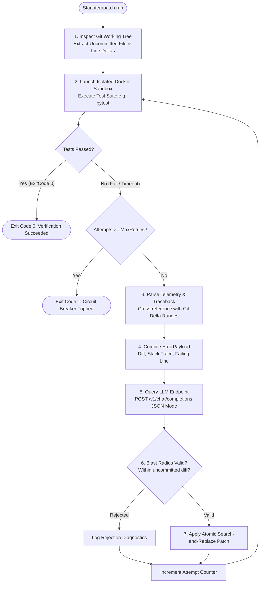

# IteraPatch

> **A model-agnostic, Git-native verification orchestrator for autonomous coding agents.**

[](https://dotnet.microsoft.com/)
[](LICENSE)
[-2496ED?logo=docker)](https://www.docker.com/)

---

## Table of Contents

- [Overview](#overview)
- [What Problem Does It Solve?](#what-problem-does-it-solve)
- [How It Works](#how-it-works)
  - [The Recursive Self-Improvement (RSI) Loop](#the-recursive-self-improvement-rsi-loop)
  - [Safety & Isolation Invariants](#safety--isolation-invariants)
  - [System Architecture](#system-architecture)
- [Language Support & Current Limitations](#language-support--current-limitations)
- [Prerequisites](#prerequisites)
- [Installation & Build](#installation--build)
- [How to Use the CLI](#how-to-use-the-cli)
  - [Command Syntax](#command-syntax)
  - [CLI Options & Flags](#cli-options--flags)
  - [Exit Codes](#exit-codes)
  - [Usage Examples](#usage-examples)
- [Programmatic API (.NET Library)](#programmatic-api-net-library)
- [Project Structure](#project-structure)
- [Running the Test Suite](#running-the-test-suite)
- [Contributing & License](#contributing--license)

---

## Overview

As software engineering shifts toward AI software factories, the core engineering bottleneck has moved from **writing code** to **verifying code**.

**IteraPatch** is a high-performance verification orchestrator built with C# (.NET 10). It intercepts code generated by autonomous coding agents before it is ever committed or sent for human review. By executing test suites inside an ephemeral, network-isolated Docker container, mapping test failure stack traces directly to the uncommitted Git delta, and communicating with an LLM via standard OpenAI-compatible endpoints, IteraPatch autonomously loops to generate and validate surgical patches until the tests pass.

---

## What Problem Does It Solve?

1. **The Human Review Bottleneck:**
   Autonomous agents generate PRs and code changes at scale. Flooding human reviewers with broken builds, regressed unit tests, or hallucinated logic slows engineering teams down. IteraPatch acts as an unyielding downstream gatekeeper that guarantees code passes tests *before* a commit or push is created.

2. **The "Hallucination Loop" and Context Rot:**
   When coding agents hit runtime errors, their context windows degrade. They frequently attempt desperate fixes—such as modifying test assertions to make failing tests "pass", deleting critical requirements, or hallucinating fixes in unrelated modules. IteraPatch arrests this behavior through strict boundary enforcement.

3. **Uncontrolled Blast Radius:**
   IteraPatch strictly isolates patches: it calculates the exact Git diff of uncommitted changes and rejects any patch suggestion that attempts to touch files or line numbers outside the active delta. Tests and clean files remain completely protected.

4. **Runaway Spend & Infinite Loops:**
   Without hard circuit breakers, autonomous retry loops can churn through API tokens endlessly. IteraPatch enforces an unyielding circuit breaker (defaulting to 3 attempts), terminating execution cleanly with deterministic exit codes if tests cannot be resolved within budget.

5. **Model & Vendor Lock-In:**
   IteraPatch does not depend on proprietary agent frameworks (e.g., LangChain, AutoGen). It communicates over standard JSON payloads with any OpenAI-compatible HTTP endpoint—including local models running on Ollama, vLLM, or LM Studio, as well as cloud providers like OpenAI, Groq, or DeepSeek.

---

## How It Works

### The Recursive Self-Improvement (RSI) Loop

IteraPatch runs an automated, multi-stage verification loop:



1. **Working Tree Inspection:** LibGit2Sharp compares the local working directory against `HEAD`, building a detailed `GitDeltaReport` of modified, added, and deleted files along with exact 1-based line intervals.
2. **Deterministic Sandboxing:** The repository is mounted read-only into an ephemeral Docker container with network access disabled (`NetworkMode = "none"`). The test command (e.g., `pytest`) runs inside the sandbox.
3. **Traceback Parsing & Fault Isolation:** `RegexTraceParser` extracts stack traces, error messages, and failing frames from test output. It checks frames against the uncommitted Git delta in reverse chronological order, tagging whether the error originated from the agent's new edits (`IsWithinGitDelta`).
4. **Structured Diagnostic Payload:** A normalized `ErrorPayload` is generated containing the error type, message, stack trace, failing line/file, current Git diff, and iteration count.
5. **Model-Agnostic Patch Request:** The payload is sent to an OpenAI-compatible `/v1/chat/completions` endpoint requesting a structured JSON patch response (`searchSnippet` and `replaceSnippet`).
6. **Blast Radius Validation:** `BlastRadiusPatchValidator` checks every proposed modification against the `GitDeltaReport`. If the LLM tries to modify clean files, delete tests, or touch lines outside the uncommitted diff, the patch is rejected immediately.
7. **Atomic Patch Application:** Validated patches are tested and applied in memory before committing to disk. If a patch fails to apply or triggers a conflict, changes are rolled back automatically.
8. **Loop or Circuit Break:** If the tests pass on the next iteration, IteraPatch exits with code `0`. If the maximum attempts (default 3) are reached without passing, the circuit breaker halts execution and exits with code `1`.

---

### Safety & Isolation Invariants

| Safety Invariant | Implementation Mechanism |
| :--- | :--- |
| **Network Isolation** | `HostConfig.NetworkMode = "none"` prevents untrusted test code from accessing external networks. |
| **Mount Immutability** | Target repository is mounted as **read-only** (`ReadOnly = true`). Transient writes are redirected to an ephemeral `/tmp` `tmpfs` mount. |
| **Container Teardown** | Ephemeral containers enforce `AutoRemove = true` and wrapped in `try/finally` blocks with explicit `RemoveContainerAsync(Force = true)` fallback to eliminate orphan container leaks. |
| **Blast Radius Containment** | Patches touching clean, untracked, or out-of-diff lines are rejected before disk modification. |
| **Atomic File Writes** | Snippet replacements are verified against all target files in memory before writing to disk; automatic rollback occurs upon any failure. |
| **Budget & Loop Limit** | Strict circuit breaker terminates after 3 iterations (or user-defined `--max-retries`) to prevent infinite spend. |

---

### System Architecture

IteraPatch follows **Clean Architecture** principles, maintaining strict separation between domain logic and infrastructure adapters:

```
+---------------------------------------------------------------------------------+
|                                IteraPatch.Cli                                   |
|   (System.CommandLine Parsing -> Pre-flight Checks -> DI Host Provider)        |
+---------------------------------------------------------------------------------+
                                       │
                                       ▼
+---------------------------------------------------------------------------------+
|                        IteraPatch.Core (Domain & Services)                      |
|                                                                                 |
|   +─────────────────────────────────────────────────────────────────────────+   |
|   |                       IOrchestratorService                              |   |
|   |         (Recursive Self-Improvement Loop & Circuit Breaker)             |   |
|   +───────┬─────────────────┬─────────────────┬─────────────────┬───────────+   |
|           │                 │                 │                 │               |
|           ▼                 ▼                 ▼                 ▼               |
|   +───────────────+ +───────────────+ +───────────────+ +───────────────+       |
|   |ISandboxService| |IGitDeltaService| | ITraceParser | |  ILlmClient   |       |
|   +───────┬───────+ +───────┬───────+ +───────┬───────+ +───────┬───────+       |
|           │                 │                 │                 │               |
|   +───────────────+ +───────────────+                 +───────────────+         |
|   |IPatchValidator| | IPatchApplier |                 | Resilient JSON|         |
|   +───────┬───────+ +───────┬───────+                 +───────────────+         |
+-----------│-----------------│-----------------------------------│---------------+
            ▼                 ▼                                   ▼
+───────────────────+ +───────────────+                 +───────────────────+
|   Docker.DotNet   | |  LibGit2Sharp |                 |   HttpClient      |
| (Network: "none", | | (WorkingTree  |                 |(OpenAI-Compatible |
|  Mount: "ro")     | |  Diff DTOs)   |                 | JSON Chat API)    |
+───────────────────+ +───────────────+                 +───────────────────+
```

---

## Language Support & Current Limitations

IteraPatch is fundamentally **language-neutral** across nearly all subsystems:

- **Docker Sandbox (`ISandboxService`):** Agnostic. Accepts any Docker runner image (`-i`, e.g. `python:3.11-slim`, `node:20-alpine`, `mcr.microsoft.com/dotnet/sdk:10.0`, `golang:1.22`, `rust:latest`) and any test command (`-t`, e.g. `pytest`, `npm test`, `dotnet test`, `cargo test`, `go test ./...`).
- **Git Delta Service (`IGitDeltaService`):** Agnostic. Tracks line-level diffs on any source file or file extension (`.py`, `.js`, `.ts`, `.cs`, `.go`, `.rs`, etc.) via `LibGit2Sharp`.
- **Blast Radius Validator (`IPatchValidator`):** Agnostic. Ensures suggested patches stay strictly within uncommitted Git diff intervals regardless of programming language.
- **Atomic Patch Applier (`IPatchApplier`):** Agnostic. Executes search-and-replace snippet modifications against any source text file with automated rollback.
- **Recursive Orchestrator (`IOrchestratorService`):** Agnostic. Enforces the verification loop, shell tokenization, and circuit breaker.

### Current MVP Limitation: The Trace Parser (`ITraceParser`)

The only component that currently specializes in a single language ecosystem is the **`RegexTraceParser`**:

- **Specialized Pytest Parsing:** In the MVP release, `RegexTraceParser` contains regular expressions specifically tuned for Python's `pytest` failure blocks (`____ test_name ____`), Python tracebacks (`File "...", line X`), assertions (`assert a == b`, `AssertionError`), and summary lines to isolate the exact failing line (`failingLine`) matching the Git delta.
- **Behavior with Non-Python Projects:** If you run IteraPatch against a non-Python repository (e.g. `--image node:20 --test-cmd "npm test"`), non-zero exit codes are still caught as test failures. The orchestrator triggers its fallback mechanism, packing the raw test output (`stdout`/`stderr`) and the full `gitDiff` into an `ExecutionFailure` payload sent to the LLM. The LLM can still generate patches and the patch applier will still apply them; however, fine-grained `failingLine` pinpointing is not available.
- **Extensibility via Clean Architecture:** Adding native, first-class trace parsing for other ecosystems (e.g. Jest, xUnit, Go test, or Cargo) requires implementing the `ITraceParser` interface and registering it with Microsoft DI:
  ```csharp
  public interface ITraceParser
  {
      TraceParseResult Parse(string stdout, string stderr, GitDeltaReport gitDelta);
  }
  ```

---

## Prerequisites

- **.NET 10 SDK** (or later) installed on your system.
- **Docker Engine** or **Docker Desktop** running with an active Docker daemon.
  > [!TIP]
  > **Zero-Config Out of the Box:** The runner container executes in network isolation (`NetworkMode = "none"`). IteraPatch automatically handles this seamlessly:
  > - **Auto-Provisioning:** On default runs, IteraPatch automatically provisions and caches an `iterapatch-python:3.11` image with `pytest` pre-installed on the first run.
  > - **Virtualenv Detection:** If your repository contains a `.venv` or `venv` directory, IteraPatch automatically prepends it to `$PATH` inside the container so all your local dependencies are picked up without configuration.
  > - **Custom Images:** You can also pass any custom container image via `-i` (e.g. `node:20`, `rust:latest`).
- **Git** installed and target repositories initialized with Git (`git init`).
- **LLM Endpoint** (OpenAI-compatible):
  - Local: [Ollama](https://ollama.com/), [vLLM](https://github.com/vllm-project/vllm), [LocalAI](https://localai.io/), or [LM Studio](https://lmstudio.ai/).
  - Cloud: OpenAI (`api.openai.com`), Groq, DeepSeek, Together, etc.

---

## Installation & Build

### 1. Clone the Repository
```bash
git clone https://github.com/your-org/IteraPatch.git
cd IteraPatch
```

### 2. Build the Solution
```bash
dotnet build
```

### 3. Run the Test Suite
Confirm that all unit and integration tests pass:
```bash
dotnet test
```

---

## How to Use the CLI

IteraPatch provides a command-line interface via the `IteraPatch.Cli` tool.

### Command Syntax

```bash
iterapatch run [options]
```

Or when running from source:

```bash
dotnet run --project IteraPatch.Cli -- run [options]
```

*(Note: You can also omit `run` and pass options directly, e.g., `dotnet run --project IteraPatch.Cli -- -r /path/to/repo`.)*

### CLI Options & Flags

| Flag | Full Option | Default | Description |
| :--- | :--- | :--- | :--- |
| `-r` | `--repo-path <path>` | `.` | Target Git repository path to verify. |
| `-t` | `--test-cmd <command>` | `pytest` | Test runner command to execute inside the sandbox. |
| `-i` | `--image <image>` | `python:3.11-slim` | Docker image used for the isolated test runner. |
| `-m` | `--max-retries <number>` | `3` | Maximum verification iterations before circuit breaker trips. |
| | `--llm-url <url>` | `http://localhost:11434/v1` | Base URL for an OpenAI-compatible API endpoint. |
| | `--llm-key <key>` | `dummy-key` | API authorization key for the LLM endpoint. |
| | `--llm-model <model>` | `gpt-4o-mini` | Name of the model to query for patch generation. |
| `-v` | `--verbose` | `false` | Enable verbose/debug logging output. |
| `-h` | `--help` | | Display help and usage information. |

### Exit Codes

IteraPatch uses standard Unix exit codes suitable for CI/CD pipelines, pre-commit hooks, or agent workflows:

- **`0`**: **Success.** All tests executed and passed (either on the first run or after self-improvement patches were applied).
- **`1`**: **Circuit Breaker Tripped.** Verification failed after reaching the maximum retry threshold (`--max-retries`).
- **`2`**: **Pre-flight or Fatal Error.** Invalid arguments, missing repository directory, invalid URL, or Docker daemon failure.

---

### Usage Examples

#### 1. Quick Local Run (Using Ollama)
Run verification on the current directory using a local Ollama instance:
```bash
dotnet run --project IteraPatch.Cli -- run \
  --llm-url "http://localhost:11434/v1" \
  --llm-model "qwen2.5-coder:7b"
```

#### 2. Run with Custom Test Runner Image
Base images like `python:3.11-slim` do not contain `pytest` by default. You can create a test image with your dependencies:
```bash
# Build a runner image with pytest and your project requirements:
docker build -t python-tester - <<'EOF'
FROM python:3.11-slim
RUN pip install --no-cache-dir pytest
EOF

# Run IteraPatch using the custom image:
dotnet run --project IteraPatch.Cli -- run \
  --repo-path "/home/user/projects/my-service" \
  --image "python-tester" \
  --test-cmd "pytest -v"
```

#### 3. Run with Cloud LLM (OpenAI)
Use OpenAI's API to verify and repair code:
```bash
dotnet run --project IteraPatch.Cli -- run \
  --llm-url "https://api.openai.com/v1" \
  --llm-key "$OPENAI_API_KEY" \
  --llm-model "gpt-4o-mini" \
  --max-retries 3
```

#### 4. Verbose Debug Mode
Inspect the Docker container execution logs, Git diff extraction, and patch generation steps:
```bash
dotnet run --project IteraPatch.Cli -- run -v \
  --repo-path . \
  --test-cmd "pytest"
```

#### 5. Integration with Git Pre-Commit Hook
Prevent unverified code from being committed by placing IteraPatch in `.git/hooks/pre-commit`:
```bash
#!/usr/bin/env bash
echo "Running IteraPatch verification gate..."
iterapatch run --max-retries 2

if [ $? -ne 0 ]; then
    echo "IteraPatch: Verification failed. Aborting commit."
    exit 1
fi
```

---

## Programmatic API (.NET Library)

You can embed IteraPatch directly into your C# applications, web services, or agent harnesses by referencing `IteraPatch.Core` and registering its services with Microsoft Dependency Injection:

```csharp
using Microsoft.Extensions.DependencyInjection;
using IteraPatch.Core.Configuration;
using IteraPatch.Core.Extensions;
using IteraPatch.Core.Interfaces;

var services = new ServiceCollection();

// Register all IteraPatch core services and configuration
services.AddIteraPatchCore(
    configureSandbox: opt =>
    {
        opt.Image = "python:3.11-slim";
        opt.TimeoutSeconds = 60;
    },
    configureLlm: opt =>
    {
        opt.BaseUrl = "http://localhost:11434/v1";
        opt.Model = "gpt-4o-mini";
        opt.ApiKey = "dummy-key";
    },
    configureOrchestrator: opt =>
    {
        opt.MaxAttempts = 3;
        opt.TestCommand = "pytest";
        opt.RepositoryPath = "/path/to/target/repo";
    });

using var provider = services.BuildServiceProvider();
using var scope = provider.CreateScope();

var orchestrator = scope.ServiceProvider.GetRequiredService<IOrchestratorService>();

var result = await orchestrator.RunVerificationLoopAsync(new OrchestratorOptions
{
    RepositoryPath = "/path/to/target/repo",
    TestCommand = "pytest",
    MaxAttempts = 3
});

if (result.Success)
{
    Console.WriteLine($"Verification succeeded after {result.TotalAttempts} attempt(s)!");
}
else
{
    Console.WriteLine($"Verification failed: {result.Message}");
}
```

---

## Project Structure

```
IteraPatch/
├── IteraPatch.slnx                      # Solution definition
├── IteraPatch.Core/                     # Core domain library & Clean Architecture services
│   ├── Configuration/                   # Sandbox, LLM, and Orchestrator options
│   │   ├── LlmOptions.cs
│   │   ├── OrchestratorOptions.cs
│   │   └── SandboxOptions.cs
│   ├── Extensions/                      # Microsoft DI registration extensions
│   │   └── ServiceCollectionExtensions.cs
│   ├── Interfaces/                      # Abstractions for Sandbox, Git, Parser, LLM, Patch
│   │   ├── IGitDeltaService.cs
│   │   ├── ILlmClient.cs
│   │   ├── IOrchestratorService.cs
│   │   ├── IPatchApplier.cs
│   │   ├── IPatchValidator.cs
│   │   ├── ISandboxService.cs
│   │   └── ITraceParser.cs
│   ├── Models/                          # Immutable records and DTOs
│   │   ├── GitModels.cs
│   │   ├── LlmModels.cs
│   │   ├── OrchestratorModels.cs
│   │   ├── SandboxModels.cs
│   │   └── TelemetryModels.cs
│   └── Services/                        # Concrete implementations
│       ├── BlastRadiusPatchValidator.cs # Blast radius containment validator
│       ├── DockerSandboxService.cs       # Network-isolated Docker.DotNet runner
│       ├── FilePatchApplier.cs           # Atomic in-memory file patcher
│       ├── LibGit2SharpGitDeltaService.cs# Git working tree delta extractor
│       ├── OpenAiCompatibleLlmClient.cs  # Resilient OpenAI HTTP client
│       ├── RecursiveVerificationOrchestrator.cs # RSI loop & circuit breaker
│       └── RegexTraceParser.cs           # Pytest & traceback telemetry parser
├── IteraPatch.Cli/                      # System.CommandLine console application
│   ├── Commands/
│   │   └── RunCommand.cs                # 'run' CLI command and options parser
│   └── Program.cs                       # Entry point and argument normalizer
├── IteraPatch.Tests/                    # Comprehensive unit and integration test suite
└── factory/
    └── FACTORY.md                       # Executive brief, architecture spec & task board
```

---

## Running the Test Suite

IteraPatch features a comprehensive xUnit test suite testing every component:
- **Sandbox Security & Lifecycle:** Tests container teardown, AutoRemove race condition handling, and network isolation settings.
- **Git Diffs & Line Ranges:** Validates working tree diff calculations across unstaged, staged, added, modified, and deleted lines.
- **Trace Parsing & Fault Isolation:** Verifies pytest traceback analysis, collection errors, native format outputs, and delta cross-referencing.
- **LLM Client & JSON Parsing:** Tests prompt serialization, auth headers, HTTP error propagation, markdown fence stripping, and JSON resilience.
- **Blast Radius & Patch Application:** Asserts rejection of out-of-diff patches, directory traversal attempts, and atomic rollbacks.
- **Orchestrator & Circuit Breakers:** Evaluates single-attempt passes, multi-attempt self-repair, and hard 3-retry circuit breaker halts.
- **CLI & DI Integration:** Validates argument parsing, options normalization, pre-flight checks, and process exit codes.

Execute the tests via the .NET CLI:

```bash
dotnet test --verbosity normal
```

---

## Contributing & License

Contributions are welcome! Please ensure all code conforms to Clean Architecture boundaries, includes corresponding unit tests in `IteraPatch.Tests`, and passes `dotnet test` before submitting pull requests.

This project is licensed under the [MIT License](LICENSE).
